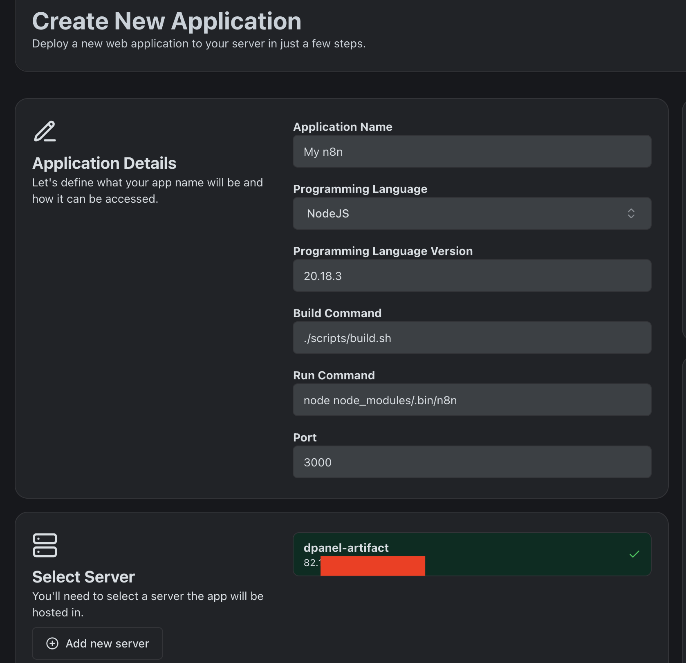
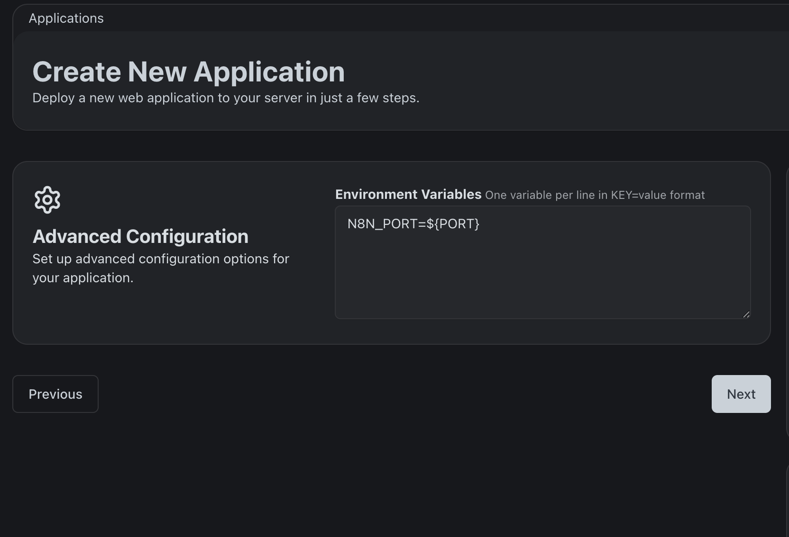

### n8n Example

This repository contains the example of n8n deployment with dPanel. You can fork this repository and follow steps below to instantly deploy to your server from any cloud providers without docker needed.

### Hardware 
For a minimal local n8n instance, you need a 64-bit operating system (Windows, macOS, or Linux), at least 4 GB of RAM, 2 CPU cores, and 2 GB of disk space for the initial setup. However, for production or heavier workloads, a production server should have a minimum of 2 dedicated vCPUs, 8 GB of RAM, and around 40 GB of SSD storage, with recommendations for 8+ vCPUs and 16+ GB of RAM for professional environments. 

### Prerequisites

- dPanel account, register [here](https://cloud.terpusat.com/auth)
- dPanel SSH key, and VPS from any cloud provider. 

Read how to register server to dPanel [here](https://cloud.terpusat.com/docs/id/installation/manual)

### Deployment

1. Login to dPanel, and create new application from git.
   

2. Input how n8n application build and deploy, select server as well
   

3. Input env variable if needed, for example change default port (5678) to (3000)
   

4. Preview application, and click `Deploy` to deploy application.
   

<!-- 2. Select `Nodejs` as application type, and fill the data click `Next`. -->