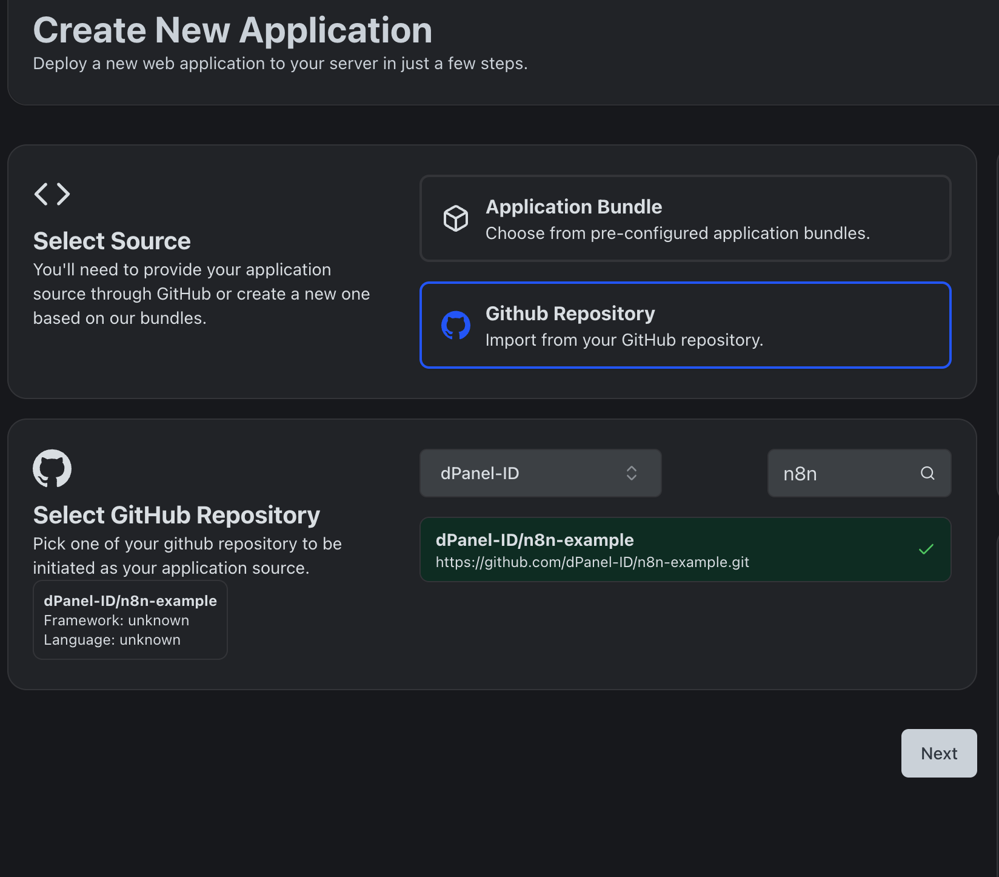
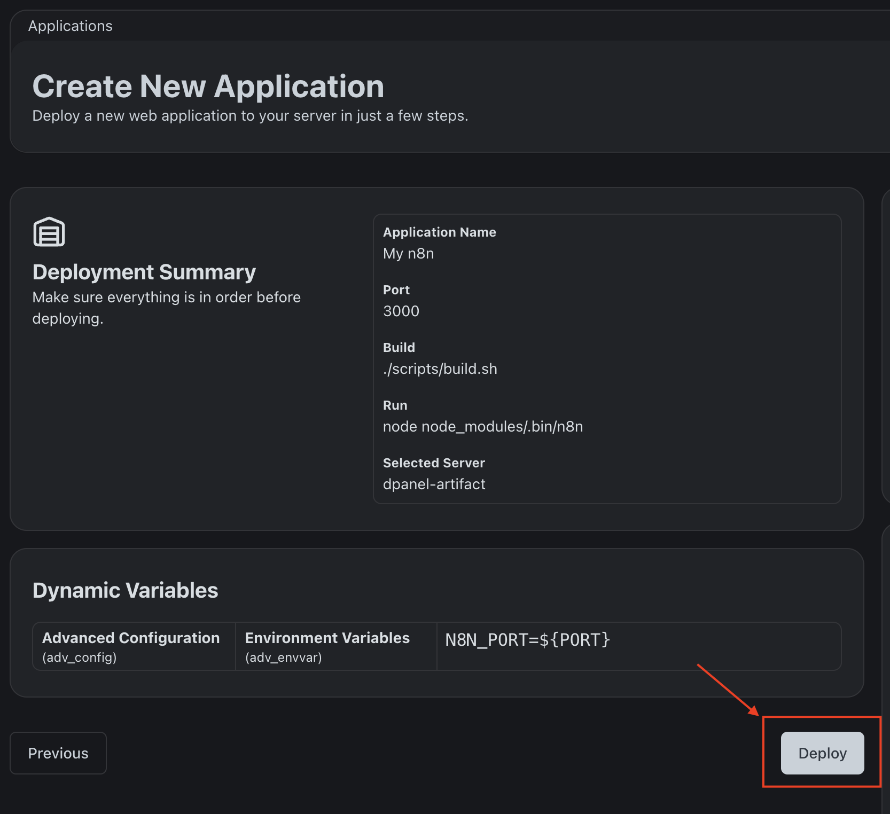

### n8n Example

This repository deploys [n8n](https://n8n.io) with dPanel on your own server, without Docker. Fork it and follow the steps below to run n8n on a VM from any cloud provider.

### Versions

| Component | Version |
| --- | --- |
| n8n | 2.48.7 |
| Node.js | 24.22.3 (n8n 2.x needs Node.js 24 or newer) |

The dPanel definition in [`.devetek/n8n-example.yml`](.devetek/n8n-example.yml) installs this Node.js version on the server, runs `scripts/build.sh` (`npm ci`) and starts n8n with `scripts/start.sh` on port 5678.

To move to a newer n8n later, change the version in `package.json`, run `npm install --package-lock-only` and commit both files. Check the `engines` field of the new n8n release (`npm view n8n engines`) and update the Node.js version in `.devetek/n8n-example.yml` and `.nvmrc` if it changed.

### Hardware

n8n is comfortable with 2 vCPUs, 4 GB of RAM and 20 GB of disk. For many workflows or heavy workloads, use 4+ vCPUs and 8+ GB of RAM.

### Prerequisites

- A dPanel account, register [here](https://dnocs.devetek.app)
- A server in dPanel: create a VM from a connected cloud account, or connect your own server.

### Deployment

1. Login to dPanel, and create a new application from this repository. Choose the definition `.devetek/n8n-example.yml`.
   

2. Check how n8n is built and run, and select your server.
   

3. Add these environment variables so n8n builds webhook URLs with your domain:

   | Key | Example |
   | --- | --- |
   | `N8N_HOST` | `n8n.example.com` |
   | `N8N_PROTOCOL` | `https` |
   | `WEBHOOK_URL` | `https://n8n.example.com/` |

4. Click `Deploy` to deploy the application.
   

5. Add a load balancer with your domain and HTTPS that points to the application on port 5678, then open the domain and create the n8n owner account.

### Run locally

```sh
./scripts/build.sh
./scripts/start.sh
```

Then open http://localhost:5678.
